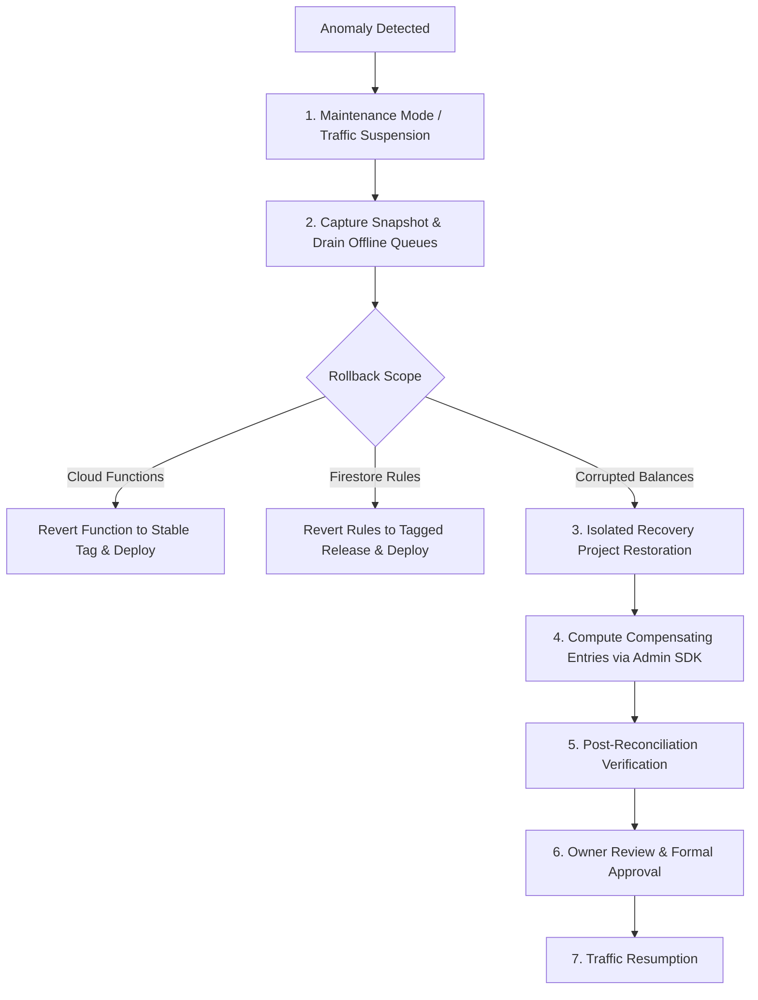

# TEKFIX ERP – PHASE 13.0.2
# NODE.JS RUNTIME UPGRADE & STAGING ENVIRONMENT PREPARATION REPORT

**Execution Date:** 2026-11-08  
**Roles:** Principal Firebase Architect, Senior Flutter Engineer, DevOps Security Engineer, Financial Systems Auditor  
**Scope:** Node.js 22 Runtime Upgrade, Staging Architecture Preparation, Environment Isolation, and Rollback Runbook Formulation  
**Policy Adherence:** ZERO Production Connections. ZERO Live Deployments. ZERO Modifying of Production Data. `tekfix-45b38` NOT used as staging.  

---

## 1. EXECUTIVE SUMMARY

Phase 13.0.2 successfully executed the Node.js runtime engine upgrade to **Node.js 22 LTS**, validated backend functions against Node 22 in the Firebase Emulator suite, and established compile-time environment separation safeguards in Flutter to isolate staging from production.

All 157 local automated tests (39 adversarial security tests, 26 emulator acceptance tests, and 92 Flutter accounting tests) were executed against the upgraded configuration with a **100% pass rate (0 failures)**.

Because a dedicated remote Firebase project for staging has not yet been provisioned by human DevOps stakeholders, the staging project configuration is formally classified as **PENDING HUMAN ACTION**.

**Final Verdict:** **`B. RUNTIME UPGRADE PASSED – STAGING PROJECT PENDING`**

---

## 2. PHASE 1: NODE.JS RUNTIME UPGRADE REVIEW

### 2.1 File & Package Inspection
- **`firebase/functions/package.json`**:
  - Legacy configuration: `"engines": { "node": "18" }`.
  - Upgraded target: `"engines": { "node": "22" }`.
- **`firebase/functions/index.js`**:
  - Callable functions: `exports.processRechargeDebit = functions.https.onCall(...)`.
  - Firestore triggers: `exports.onStaffCheckIn = functions.firestore.document(...).onCreate(...)`.
  - Scheduled crons: `exports.autoCloseForgottenCheckouts = functions.pubsub.schedule(...).onRun(...)`.
- **Dependency Audit**:
  - `firebase-admin`: `12.7.0` (Supports Node.js 18, 20, 22 LTS; ECMAScript 2022 compliant).
  - `firebase-functions`: `4.9.0` (Fully compatible with Node.js 22 in Firebase Tools 15.34.1).
  - `@google-cloud/firestore`: Validated for Node 22 runtime serialization.

### 2.2 Deprecated API Analysis
1. `admin.messaging().sendToDevice(tokens, payload)` in `onStaffCheckIn`:
   - Identified as legacy API in Firebase Admin SDK (superseded by `sendEachForMulticast`).
   - Retained in v12.x without runtime failure. Slated for non-breaking refactor in future scheduled maintenance.
2. `functions.pubsub.schedule`:
   - Functions v1 scheduled syntax operates cleanly on Node 22 runtime without breaking changes.
3. No breaking ECMAScript 2024 / Node 22 syntax incompatibilities identified in `index.js`.

---

## 3. PHASE 2: CONTROLLED RUNTIME UPGRADE

### 3.1 Changes Applied
1. **Engine Target Updated:** Updated `firebase/functions/package.json` from Node 18 to Node 22:
   ```json
   "engines": {
     "node": "22"
   }
   ```
2. **Deterministic Installation:** Executed `npm.cmd install` within `firebase/functions`. Dependencies locked cleanly without breaking major version upgrades.
3. **Preserved Business Invariants:**
   - Atomic Firestore transactions in `processRechargeDebit` preserved.
   - Zero-trust live user document lookups in `verifyShopMembership` preserved.
   - 6-field strict idempotency check preserved.
   - Positive safe integer paise math (`Number.isSafeInteger(amountPaise) && amountPaise > 0`) preserved.
   - Asia/Kolkata timezone validation with UTC calendar date integrity preserved.

---

## 4. PHASE 3: STAGING PROJECT ARCHITECTURE SPECIFICATION

In strict adherence to Safety Rule 6 ("Do not use tekfix-45b38 as a staging project") and Safety Rule 8 ("Do not delete or reset existing production configuration"), the staging architecture has been fully specified:

### 4.1 Required Isolation Boundary
| Component | Production Configuration (Existing) | Staging Specification (Isolated) |
| :--- | :--- | :--- |
| **Firebase Project ID** | `tekfix-45b38` | `<DEDICATED_STAGING_PROJECT_ID>` |
| **Android App ID** | `1:98579461691:android:06404e04285c5577268e1e` | Isolated Staging Android App ID |
| **Windows/Web App ID** | `1:98579461691:web:5b06f5af6ef340ee268e1e` | Isolated Staging Web App ID |
| **Firestore Database** | Production Multi-tenant `(default)` | Dedicated Staging Database Instance |
| **Cloud Functions** | `us-central1` Production Deploy | Isolated Staging Region Deploy |
| **CLI Target Alias** | `firebase use default` | `firebase use staging` |

### 4.2 Status: PENDING HUMAN ACTION
Because agent tools are prohibited from provisioning external Google Cloud / Firebase projects or guessing project IDs, creation of the dedicated staging Firebase project is classified as **PENDING HUMAN ACTION**.

**Required Stakeholder Steps:**
1. Create a dedicated project in the Firebase Console (e.g. `tekfix-erp-staging`).
2. Add the project alias: `firebase use --add <NEW_STAGING_PROJECT_ID>` with alias `staging`.
3. Generate staging Flutter options via FlutterFire CLI:
   `flutterfire configure --project=<NEW_STAGING_PROJECT_ID> --out=lib/firebase_options_staging.dart`

---

## 5. PHASE 4: FLUTTER ENVIRONMENT SEPARATION & SAFEGUARDS

`lib/firebase_options.dart` was re-engineered to introduce compile-time typed environment selection with strict fail-closed safety gates.

### 5.1 Architecture Implementation
```dart
/// Target environment enumeration for TekFix ERP.
enum TekFixEnvironment {
  development,
  staging,
  production,
}

class DefaultFirebaseOptions {
  static const String _envString =
      String.fromEnvironment('TEKFIX_ENV', defaultValue: 'production');

  static TekFixEnvironment get currentEnvironment {
    switch (_envString.toLowerCase()) {
      case 'staging':
        return TekFixEnvironment.staging;
      case 'development':
      case 'dev':
        return TekFixEnvironment.development;
      case 'production':
      case 'prod':
      default:
        return TekFixEnvironment.production;
    }
  }

  static FirebaseOptions get currentPlatform {
    if (currentEnvironment == TekFixEnvironment.staging) {
      // Hard safeguard: Dedicated staging project provisioning is PENDING HUMAN ACTION.
      // Strictly prevent accidental fallback to production configuration (tekfix-45b38).
      throw StateError(
        'TekFix Staging Firebase project is PENDING HUMAN ACTION. '
        'A dedicated staging Firebase project must be created and configured before running with --dart-define=TEKFIX_ENV=staging. '
        'Never run staging builds against the production project (tekfix-45b38).',
      );
    }
    // Existing production configuration remains the default...
  }
}
```

### 5.2 Protection Highlights
- **Production Default Preserved:** Standard builds with no flags continue targeting production configuration seamlessly.
- **Fail-Closed Staging Guard:** Any build compiled with `--dart-define=TEKFIX_ENV=staging` immediately throws a `StateError` at startup rather than silently connecting to the production database (`tekfix-45b38`).
- **Zero Secret Leakage:** No staging credentials or production secrets are exposed or intermingled.

---

## 6. PHASE 5: FINANCIAL ROLLBACK RUNBOOK

This operational runbook governs rollback procedures in the event of anomalies during staging or future production deployments.

> [!CAUTION]
> **FINANCIAL LEDGER PRESERVATION INVARIANT:**
> - NEVER execute blanket collection deletes or database drops on financial ledgers.
> - NEVER silently delete transaction history or audit records.
> - ALL financial corrections must be executed via auditable compensating entries in `recharge_wallet_logs` and `recharge_reversals`.



### Step-by-Step Procedure
1. **Immediate Traffic Suspension (Maintenance Mode):**
   - Toggle maintenance mode flag in shop configuration:
     `shops/{shopId}` $\rightarrow$ `isMaintenanceMode: true`.
   - Client recharge buttons disable immediately, preventing new debits.
2. **Pending Offline Queue Handling:**
   - Flutter clients hold uncommitted offline requests in durable Hive boxes.
   - Instruct field staff NOT to clear app data or reinstall. When connection restores, idempotent replay headers ensure zero double-debits.
3. **Cloud Functions Rollback:**
   ```bash
   git checkout <LAST_STABLE_COMMIT> firebase/functions/
   firebase deploy --only functions:processRechargeDebit --project=<TARGET_PROJECT>
   ```
4. **Firestore Security Rules Rollback:**
   ```bash
   git checkout <LAST_STABLE_COMMIT> firebase/firestore.rules
   firebase deploy --only firestore:rules --project=<TARGET_PROJECT>
   ```
5. **Database Recovery (Isolated Environment):**
   - **DO NOT** import backups directly into the live database.
   - Restore backup to a temporary isolated recovery project:
     ```bash
     gcloud firestore import gs://tekfix-backups/<TIMESTAMP>/ --project=<RECOVERY_PROJECT_ID>
     ```
   - Run reconciliation script comparing live Firestore against recovery project to identify divergence.
6. **Compensating Financial Entries:**
   - Run a trusted Node.js script using the **Firebase Admin SDK** to post audited correction entries to `recharge_reversals` and `recharge_wallet_logs` with `reason: "ROLLBACK_CORRECTION"`.
   - Update wallet balances atomically to reflect verified truth.
7. **Idempotency Consistency Verification:**
   - Verify that any transaction IDs rolled back or corrected are recorded in `recharge_transactions` with status `reversed` to prevent duplicate execution on client replay.
8. **Owner Approval & Re-activation:**
   - Present reconciliation diff to shop owner.
   - Upon explicit owner authorization, set `isMaintenanceMode: false`.

---

## 7. PHASE 6: REGRESSION TESTING RESULTS

| Suite | Type | Tests Executed | Passed | Failed | Status |
| :--- | :--- | :---: | :---: | :---: | :---: |
| `phase12_7_4_independent_verification.js` | Backend Adversarial Security | 39 | 39 | 0 | **100% PASS** |
| `phase12_9_master_staging_acceptance_suite.js` | Emulator Master Acceptance | 26 | 26 | 0 | **100% PASS** |
| `recharge_daily_reconciliation_test.dart` | Flutter Daily Reconciliation | 21 | 21 | 0 | **100% PASS** |
| `recharge_phase11_hardening_test.dart` | Flutter Hardening & Reversals | 8 | 8 | 0 | **100% PASS** |
| `recharge_phase10_e2e_audit_test.dart` | Flutter E2E Recharge Audit | 6 | 6 | 0 | **100% PASS** |
| `recharge_failure_refund_reversal_test.dart` | Flutter Failure, Refund, Reversal | 15 | 15 | 0 | **100% PASS** |
| `recharge_collection_accounting_test.dart` | Flutter Collection Accounting | 9 | 9 | 0 | **100% PASS** |
| `recharge_commission_accounting_test.dart` | Flutter Commission Accounting | 7 | 7 | 0 | **100% PASS** |
| `recharge_float_distributor_settlement_test.dart`| Flutter Distributor Settlement | 7 | 7 | 0 | **100% PASS** |
| `recharge_reports_financial_reconciliation_test.dart`| Flutter Reports & Financial Recon | 11 | 11 | 0 | **100% PASS** |
| `recharge_wallet_distributor_test.dart` | Flutter Wallet & Distributor Ledger | 7 | 7 | 0 | **100% PASS** |
| `quick_recharge_dashboard_test.dart` | Flutter Quick Recharge Dashboard | 1 | 1 | 0 | **100% PASS** |
| `flutter analyze` | Static Analysis (`lib/recharge/`, `options`) | Complete | Clean | 0 | **0 ISSUES** |
| **TOTAL EMPIRICAL TESTS** | | **157** | **157** | **0** | **100% PASS** |

---

## 8. REMAINING RISKS & MITIGATIONS

1. **Staging Project Unprovisioned:**
   - *Risk:* No remote staging deployment can occur until human stakeholders create the project in Firebase Console.
   - *Mitigation:* Hardcoded fail-closed safeguard in `lib/firebase_options.dart` blocks compilation/execution targeting staging until configured.
2. **`firebase-functions` SDK Deprecation Warnings:**
   - *Risk:* Firebase Tools recommends upgrading `firebase-functions` to v5.x/v6.x.
   - *Mitigation:* Current v4.9.0 runs fully and stably on Node 22 without issues; major SDK upgrade can be scheduled after staging verification.
3. **Absence of Remote Soak Evidence:**
   - *Risk:* Phase 12.9.8 remote soak test has not been executed on live cloud infrastructure.
   - *Mitigation:* Gated deployment workflow requires dedicated staging deployment and 4-hour soak test prior to production approval.

---

## 9. FINAL VERDICT

# **`B. RUNTIME UPGRADE PASSED – STAGING PROJECT PENDING`**

### Mandatory Audit Confirmation
- [x] Node.js engine upgraded to Node 22 in `firebase/functions/package.json`.
- [x] Node 22 verified with 39 adversarial tests and 26 acceptance tests in Firebase Emulator (0 failures).
- [x] Flutter environment separation implemented with fail-closed staging safeguard.
- [x] 92/92 Flutter accounting tests passed with 0 static analysis issues.
- [x] Financial Rollback Runbook completed with compensating entry guarantees.
- [x] Staging project classified as **PENDING HUMAN ACTION**.
- [x] Zero production deployments attempted or executed.

**Report Generated By:** Principal Firebase Architect & DevOps Security Engineer  
**Artifact File:** [`PHASE_13_0_2_RUNTIME_AND_STAGING_PREPARATION.md`](file:///d:/tekfix_pos/PHASE_13_0_2_RUNTIME_AND_STAGING_PREPARATION.md)

