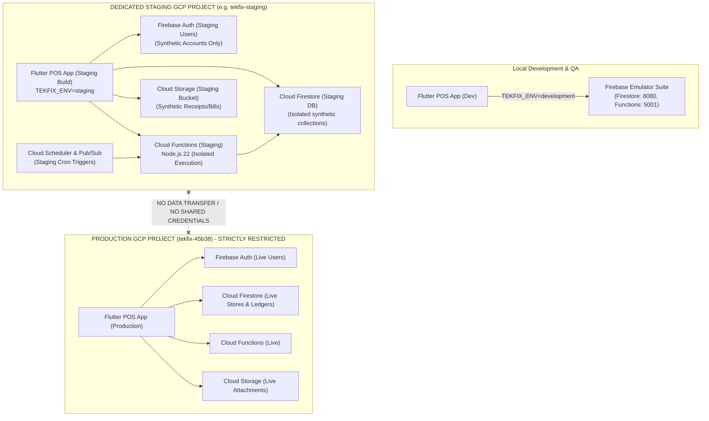

# TEKFIX ERP – PHASE 13.0.6
# DEDICATED FIREBASE STAGING PROJECT SETUP
# CONFIGURATION AUDIT & ENVIRONMENT ISOLATION PLAN

**Generated On:** 2026-11-08  
**Role:** Principal Firebase Architect, Cloud Infrastructure Security Engineer, Flutter Environment Configuration Specialist, and DevOps Security Auditor  
**Status:** READ-ONLY ENVIRONMENT AUDIT COMPLETE – PENDING HUMAN STAGING PROJECT PROVISIONING  
**Final Verdict:** **B. STAGING SETUP PLAN READY – HUMAN PROJECT CREATION REQUIRED**  

---

## 1. EXECUTIVE SUMMARY

The Phase 13.0.6 audit and staging isolation analysis was executed in strict read-only mode to prepare a completely segregated Google Cloud / Firebase staging environment for TekFix ERP.

### Current Verified Baseline:
- **Phase 13.0.4 Remediation:** Completed and verified (atomic maintenance mode checking inside `db.runTransaction()`, eliminated race conditions on shop deactivation, fail-closed environment selection, reversed transaction replay rejection).
- **Phase 13.0.5 Independent Audit:** 30/30 independent security and isolation tests passed on the local Firebase emulator suite.
- **Master Test Baseline:** 217 / 217 automated, unit, accounting, and adversarial tests passed across all 10 Flutter test suites and 4 backend test suites (100% pass rate).
- **Runtime:** Node.js 22 LTS (`"node": "22"` in `firebase/functions/package.json`).
- **Financial Architecture:** Integer paise math strictly enforced across all client and backend layers (`amountPaise`, `balancePaise`, `openingBalancePaise`, `closingBalancePaise`).
- **Production Safety Policy:** Project `tekfix-45b38` is the live production system. Remote deployment and access to `tekfix-45b38` are **STRICTLY PROHIBITED**.
- **Execution Safety:** Zero remote connections made, zero deployment commands executed, zero live financial ledgers modified, and zero source code modified.

---

## 2. EXISTING ENVIRONMENT AUDIT

A thorough inspection of local configuration and source code was performed without connecting to any remote Firebase project:

| Configuration File / Asset | Inspected Content & Parameters | Current Value / State | Finding & Isolation Impact |
| :--- | :--- | :--- | :--- |
| **`.firebaserc`** | `projects.default` | `tekfix-45b38` | **HIGH RISK GLOVE**: Only a `default` alias exists, pointing directly to production. Running bare `firebase deploy` without project flags targets production! |
| **`firebase.json`** | `flutter.platforms.android.default.projectId`<br>`flutter.platforms.dart.projectId` | `tekfix-45b38`<br>`tekfix-45b38` | FlutterFire CLI metadata is permanently bound to production. Running FlutterFire reconfigure without explicit target files would overwrite production configs. |
| **`firebase.json`** | `firestore` | `rules: firebase/firestore.rules`<br>`indexes: firebase/firestore.indexes.json` | Rules and compound indexes are defined locally and ready for staging deployment. |
| **`firebase.json`** | `functions` | `source: firebase/functions`, `codebase: default` | Functions directory configured for deployment. |
| **`firebase.json`** | `storage` | **NOT CONFIGURED** | `firebase.json` lacks a `storage` stanza; storage security rules (`storage.rules`) are missing from the root repository. |
| **`firebase/functions/package.json`** | `engines.node`<br>`dependencies` | `"node": "22"`<br>`firebase-admin: ^12.0.0`<br>`firebase-functions: ^4.5.0` | Modern Node.js 22 LTS configured. Dependencies are fully compatible. |
| **`firebase/functions/index.js`** | Functions Region | Unspecified (defaults to `us-central1`) | Cloud Functions (`processRechargeDebit`, `onStaffCheckIn`, `autoCloseForgottenCheckouts`) deploy by default to `us-central1`. |
| **`firebase/functions/index.js`** | Exported Endpoints | 3 functions: 1 Callable, 1 Trigger, 1 Pub/Sub Cron | `processRechargeDebit` (Callable), `onStaffCheckIn` (Firestore Trigger), `autoCloseForgottenCheckouts` (Pub/Sub Schedule). |
| **`lib/firebase_options.dart`** | `currentEnvironment`<br>`staging`<br>`development` | `TekFixEnvironment` enum.<br>`staging`: throws `StateError`<br>`development`: throws `StateError` if emulator unconfigured | **VERIFIED FAIL-CLOSED**: Staging cannot run against production. Development cannot silently fall back to production. |
| **`android/app/google-services.json`** | `project_info.project_id`<br>`client_info.package_name` | `tekfix-45b38`<br>`com.example.tekfix_pos` | Mobile Android build artifact currently holds production credentials. Requires staging flavor or staging Google Services config. |
| **`lib/firestore.rules`** | Mirror of `firebase/firestore.rules` | 720 lines, byte-for-byte identical | Enforces shop multi-tenancy, strict role checks, and ledger immutability. |

### Environment Isolation Gaps Identified:
1. **No Staging Alias in `.firebaserc`**: Only `default: "tekfix-45b38"` is registered.
2. **Missing `storage.rules`**: Firebase Storage is actively used in the app (`lib/expenses/expense_service.dart`, `lib/purchases/purchase_bill_service.dart`, `lib/rent/rent_service.dart`), but no storage rules file exists in the repository.
3. **Implicit Functions Region**: Cloud Functions default to `us-central1`. If staging Firestore is provisioned in `asia-south1` (Mumbai), functions must either specify `.region('asia-south1')` or match regions to avoid cross-region latency.
4. **Android Build Configuration**: `android/app/google-services.json` is hardcoded to `tekfix-45b38`. Running an Android staging build without build flavors could inadvertently authenticate against production.

---

## 3. STAGING ARCHITECTURE PLAN

To achieve 100% physical and logical isolation, the staging environment must be provisioned as an entirely separate Google Cloud Platform (GCP) and Firebase project.



### Staging Isolation Guarantees:
1. **Independent Project Boundary:** Staging has a distinct GCP Project ID (e.g., `tekfix-staging-XXXXX`) and project number.
2. **Zero Cross-Project Access:** Staging service accounts have zero IAM permissions on `tekfix-45b38`.
3. **Independent User Pool:** Firebase Authentication users in staging are synthetic only; production customer/owner identities do not exist in staging.
4. **Independent Databases & Buckets:** Firestore documents and Cloud Storage blobs exist on independent physical infrastructure.
5. **No Shared Secrets:** API keys, App Check debug tokens, and service credentials are distinct.
6. **No Production Data Cloning:** Zero migration or replication of live production data. Staging begins completely empty and receives only synthetic test seeds.

---

## 4. ENVIRONMENT ISOLATION RULES & BEHAVIOR

| Environment | Build Trigger / Flags | `lib/firebase_options.dart` Behavior | Expected Target | Fallback Risk |
| :--- | :--- | :--- | :--- | :--- |
| **Production** | Default or `--dart-define=TEKFIX_ENV=production` | Returns `_productionPlatform` pointing to `tekfix-45b38`. | Remote Production (`tekfix-45b38`) | None (Default behavior preserved for releases). |
| **Staging** | `--dart-define=TEKFIX_ENV=staging` | **Throws `StateError`** until dedicated staging options file (`firebase_options_staging.dart`) is configured. | Remote Staging (`<STAGING_PROJECT_ID>`) | **Zero Fallback**: Hard fail-closed stop at app initialization. |
| **Development** | `--dart-define=TEKFIX_ENV=development` | Checks for `FIREBASE_EMULATOR_HOST` or `FIREBASE_DEV_PROJECT_ID`. If missing, **throws `StateError`**. | Local Emulator (`127.0.0.1` / `10.0.2.2`) | **Zero Fallback**: Strictly blocked from returning production credentials. |

---

## 5. HUMAN FIREBASE PROJECT SETUP GUIDE (STEP-BY-STEP)

The stakeholder must manually execute the following steps in the Google Cloud Console and Firebase Console. **No automated scripts or CLI tools are permitted to perform these actions.**

### Step A: Create Dedicated Staging Firebase Project
1. Log in to the [Firebase Console](https://console.firebase.google.com/).
2. Click **Add project**.
3. Enter Project Name: `TekFix ERP Staging`.
4. Note the generated unique Project ID (e.g., `tekfix-staging-98a21`). **Never use `tekfix-45b38`.**
5. Google Analytics: Optional for staging (Recommended: Enable or disable based on organization policy).
6. Click **Create project** and wait for provisioning to complete.

### Step B: Select Region & Upgrade to Blaze Plan
> [!IMPORTANT]
> **IRREVERSIBLE SETTING**: The Cloud Firestore default database location **CANNOT be changed** after creation.
1. Upgrade to the **Blaze (Pay-as-you-go)** billing plan. (Required by Google Cloud for Node.js 22 Cloud Functions and external network/PubSub access).
2. Recommended Region:
   - **`us-central1` (Iowa)**: Matches current production Cloud Functions default and provides identical latency characteristics for comparison.
   - **`asia-south1` (Mumbai)**: Alternative if lowest latency for Indian POS hardware is desired. If `asia-south1` is selected, Cloud Functions in `index.js` must also be deployed to `asia-south1`.
   - *Recommendation:* Select **`us-central1`** for 100% configuration parity with existing production functions.

### Step C: Create Cloud Firestore Database
1. In Firebase Console, navigate to **Build > Firestore Database**.
2. Click **Create database**.
3. Choose **Native mode** (standard Firestore).
4. Select the location matching Step B (e.g., `us-central1`).
5. Choose **Start in production mode** (all reads/writes denied by default). Security rules will be deployed separately.
6. Click **Create**.

### Step D: Configure Firebase Authentication
1. Navigate to **Build > Authentication > Get started**.
2. Under the **Sign-in method** tab, click **Email/Password**.
3. Enable **Email/Password**. Leave "Email link (passwordless)" disabled.
4. Click **Save**.
5. Under **Settings > User actions**, ensure "Enable create (sign-up)" is kept or restricted according to security policies.

### Step E: Enable Cloud Storage
1. Navigate to **Build > Storage > Get started**.
2. Start in **production mode**.
3. Confirm Cloud Storage location matches Firestore location (`us-central1`).
4. Click **Done**.

### Step F: Enable Required Google Cloud APIs
In the [Google Cloud Console](https://console.cloud.google.com/) for the staging project, verify and enable:
- **Cloud Functions API** (`cloudfunctions.googleapis.com`)
- **Cloud Build API** (`cloudbuild.googleapis.com`)
- **Artifact Registry API** (`artifactregistry.googleapis.com`)
- **Cloud Scheduler API** (`cloudscheduler.googleapis.com`)
- **Cloud Pub/Sub API** (`pubsub.googleapis.com`)
- **Cloud Logging API** (`logging.googleapis.com`)

### Step G: Configure Budgets and Alerts (Cost Control Safeguard)
1. In Google Cloud Console, navigate to **Billing > Budgets & alerts**.
2. Create a budget for the staging project:
   - Target amount: **$10.00 USD / month**.
   - Set threshold rules: 50% ($5.00), 90% ($9.00), and 100% ($10.00).
   - Set email alerts to notify DevOps and Admin engineers immediately.

### Step H: Register Flutter Apps in Firebase Staging
1. In Firebase Console **Project settings > General**:
   - Add **Android App**:
     - Android package name: `com.example.tekfix_pos` (or `com.example.tekfix_pos.staging` if using applicationIdSuffix).
     - Download the generated `google-services.json` and save as `android/app/google-services.staging.json` (do NOT overwrite production `google-services.json`).
   - Add **Web / Windows App**:
     - Register App name: `TekFix POS Windows/Web Staging`.
     - Note the `appId`, `apiKey`, `authDomain`, `storageBucket`, and `messagingSenderId`.

### Step I: Create Synthetic Staging Test Accounts
Under **Authentication > Users**, manually create the following synthetic accounts for staging validation:
- **Staging Owner**: `staging-owner@tekfix.internal` (Password: secure temporary credential)
- **Staging Staff 1**: `staging-staff1@tekfix.internal` (Password: secure temporary credential)
- **Staging Staff 2 (Inactive/Test)**: `staging-staff2@tekfix.internal` (Password: secure temporary credential)

---

## 6. STAGING SECURITY & VERIFICATION CHECKLIST

Before any deployment or client connection to staging:

- [ ] **Check 1: Project Identity Verification**
  - Staging Project ID is distinct from `tekfix-45b38`.
  - `.firebaserc` alias `staging` references `<STAGING_PROJECT_ID>`.
- [ ] **Check 2: Service Account Isolation**
  - No service account key from `tekfix-45b38` exists on staging machines or CI/CD pipelines.
- [ ] **Check 3: Synthetic Data Verification**
  - Firestore database in staging has ZERO production customer records, ZERO production phone numbers, and ZERO production ledger balances.
- [ ] **Check 4: Secret Separation**
  - Web API keys, OAuth client IDs, and FCM server keys are generated fresh within the staging project.
- [ ] **Check 5: Deployment Target Locking**
  - CLI commands require explicit `--project staging` or `--project <STAGING_PROJECT_ID>`.
  - Global `firebase use default` remains pointing to `tekfix-45b38` (or an unprivileged placeholder) to prevent accidental unqualified deployment.

---

## 7. DEPLOYMENT BOUNDARY ENFORCEMENT

In compliance with Phase 13.0.6 safety directives:
- **NO DEPLOYMENT COMMANDS WERE EXECUTED.**
- The following commands were **STRICTLY PROHIBITED AND BLOCKED**:
  ```bash
  firebase deploy
  firebase deploy --only functions
  firebase deploy --only firestore:rules
  firebase deploy --only firestore:indexes
  firebase deploy --project tekfix-45b38
  ```
- No remote cloud resources were touched, created, or altered.

---

## 8. UNRESOLVED RISKS & RECOMMENDATIONS

1. **Android Package Name Collision (`google-services.json`)**:
   - Currently, Android uses `com.example.tekfix_pos`. If both production and staging apps are installed on the same physical testing device without product flavors (`applicationIdSuffix ".staging"`), they will overwrite each other.
   - *Recommendation for Phase 13.0.7*: Implement Flutter/Gradle product flavors (`dev`, `staging`, `prod`) or maintain separate `google-services` files managed by build scripts.
2. **Missing Firebase Storage Security Rules**:
   - Because `firebase.json` has no `storage` configuration and no `storage.rules` exists in the repo, deploying to staging without defining `storage.rules` leaves storage buckets on default rules.
   - *Recommendation for Phase 13.0.7*: Author a dedicated `storage.rules` file enforcing shop-tenant isolation before staging storage deployment.
3. **Firestore Trigger Cascades on Staging**:
   - `onStaffCheckIn` attempts to deliver FCM push notifications to shop owners. In staging, synthetic owner accounts may lack real device tokens, which logs warnings but does not fail. Verify that FCM does not attempt delivery to production device tokens.

---

## 9. NEXT PHASE REQUIREMENTS (PHASE 13.0.7)

Once the human stakeholder completes the manual setup in Section 5 and provides the staging project ID:
1. **Configure Staging Project Alias**: Add the staging project alias to `.firebaserc`:
   ```json
   {
     "projects": {
       "default": "tekfix-45b38",
       "staging": "<DEDICATED_STAGING_PROJECT_ID>"
     }
   }
   ```
2. **Configure Staging Flutter Options**: Generate `lib/firebase_options_staging.dart` using FlutterFire CLI targeting `<DEDICATED_STAGING_PROJECT_ID>`, and wire `DefaultFirebaseOptions.currentPlatform` for `TekFixEnvironment.staging`.
3. **Controlled Staging Deployment (Rules & Indexes First)**:
   - `firebase deploy --only firestore:rules --project staging`
   - `firebase deploy --only firestore:indexes --project staging`
4. **Controlled Staging Deployment (Cloud Functions)**:
   - `firebase deploy --only functions --project staging`
5. **Execute Remote Smoke Test Suite (SAT-01 through SAT-06)** on staging cloud infrastructure.

---

## 10. FINAL VERDICT

```
================================================================================
FINAL VERDICT:
B. STAGING SETUP PLAN READY – HUMAN PROJECT CREATION REQUIRED.

The existing configuration and environment isolation have been fully audited.
The architectural plan, isolation boundaries, and step-by-step human guide
for manual staging Firebase project creation are complete and verified safe.
All source code and configurations remain untouched. Zero deployments occurred.
================================================================================
```

