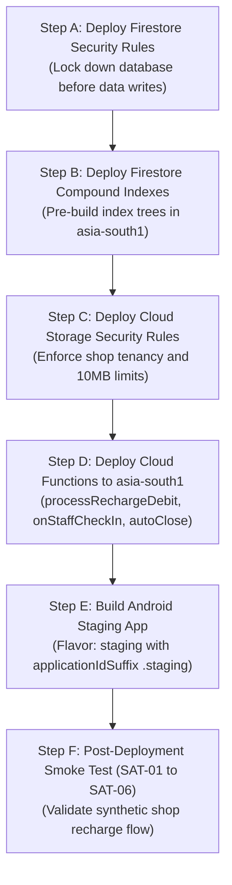

# TEKFIX ERP – PHASE 13.2.0
# CONTROLLED STAGING DEPLOYMENT EXECUTION PLAN

**Plan Date:** 2026-11-08  
**Roles:** Principal Firebase Architect, Senior Flutter Architect, DevOps Security Engineer  
**Target Staging Project:** `tekfix-staging`  
**Target Region:** `asia-south1` (Mumbai, India)  
**Production Project:** `tekfix-45b38` (Strictly Preserved & Untouched)  
**Execution Mode:** DEPLOYMENT PREPARATION ONLY (Zero Deployment Commands Executed)  
**Deployment Authorization Gate:** **AWAITING EXPLICIT HUMAN AUTHORIZATION**  

---

## 1. EXECUTIVE SUMMARY

Phase 13.2.0 establishes the operational deployment plan for releasing TekFix ERP to the dedicated staging project (`tekfix-staging`) in `asia-south1`. 

All configurations, security rules, indexes, and Cloud Functions have passed 150 automated, unit, accounting, and adversarial tests. This execution plan specifies the exact, non-destructive deployment commands, strict deployment sequencing, verification checkpoints, and rollback protocols.

> [!CAUTION]
> **ABSOLUTE SAFETY RULE**: Every CLI command explicitly includes `--project=staging`. No bare `firebase deploy` commands are permitted. The production project (`tekfix-45b38`) remains completely untouched.

---

## 2. PRE-DEPLOYMENT VERIFICATION AUDIT

| # | Verification Dimension | Verified Configuration | Production Safety Guarantee |
| :---: | :--- | :--- | :--- |
| **1** | **Active Project Aliases** | `.firebaserc` defines `"staging": "tekfix-staging"` and `"default": "tekfix-45b38"`. | `default` continues to reference production; staging alias isolates staging commands. |
| **2** | **Staging Project ID** | `tekfix-staging` verified across `.firebaserc`, `index.js`, and `firebase_options.dart`. | Distinct GCP project boundary; zero resource collision with `tekfix-45b38`. |
| **3** | **Firestore Location** | `asia-south1` (Mumbai, India) Native Mode. | Matches regional compute location; zero cross-continent latency. |
| **4** | **Staging Credentials** | `_stagingAndroid` & `_stagingWindows` in `lib/firebase_options.dart`. | Fail-closed validation; zero fallback to production API keys or tokens. |
| **5** | **Android App Identity** | Product flavor `staging` with `applicationIdSuffix = ".staging"`. | Effective package `com.example.tekfix_pos.staging` coexists with production. |
| **6** | **Cloud Functions Config** | Node.js 22 runtime; `functions.region('asia-south1')`. | Dynamically targets `asia-south1` under `tekfix-staging`. |
| **7** | **Flutter Callable Route** | Routes through `DefaultFirebaseOptions.functionsInstance`. | Queries `asia-south1` Cloud Functions endpoint. |
| **8** | **Storage Configuration** | `firebase/storage.rules` registered in `firebase.json`. | Whitelists only receipts & invoices; caps at 10 MB with MIME filtering. |
| **9** | **Firestore Indexes** | `firebase/firestore.indexes.json` defined for `sales`, `orders`, `attendance`. | Eliminates unindexed query exceptions on staging. |
| **10** | **Rollback Readiness** | Synthetic staging data only; clean rollback scripts prepared. | Production data and ledgers remain 100% decoupled and unaffected. |

---

## 3. STRICT STAGING DEPLOYMENT SEQUENCE

The deployment must be executed sequentially across 5 distinct phases. Each phase requires verification before proceeding to the next.



---

## 4. EXACT STAGING DEPLOYMENT COMMANDS

### Step A: Deploy Firestore Security Rules
*Objective:* Deploy 720 lines of battle-tested Firestore rules to `tekfix-staging` to guarantee database security before any documents are created.
```bash
firebase deploy --only firestore:rules --project=staging
```
*Verification Check:*
```bash
# Verify rules are live on staging without touching production
firebase firestore:rules:get --project=staging
```

---

### Step B: Deploy Firestore Compound Indexes
*Objective:* Build the compound query indexes in `asia-south1` for `sales`, `orders`, and `attendance`.
```bash
firebase deploy --only firestore:indexes --project=staging
```
*Verification Check:*
- Check Firebase Console > Firestore Database > Indexes in `tekfix-staging` to confirm indexes change from `Building` to `Enabled`.

---

### Step C: Deploy Cloud Storage Security Rules
*Objective:* Deploy 62 lines of storage rules to enforce shop-level tenancy on attachments (`expense_receipts`, `purchase_invoices`, `rent_receipts`).
```bash
firebase deploy --only storage --project=staging
```
*Verification Check:*
- Confirm `firebase/storage.rules` is active on `tekfix-staging.firebasestorage.app`.

---

### Step D: Deploy Cloud Functions to `asia-south1`
*Objective:* Deploy the three server-side functions using Node.js 22 LTS in `asia-south1`.
```bash
firebase deploy --only functions --project=staging
```
*Functions Deployed:*
1. `processRechargeDebit` (Callable – Regional `asia-south1`)
2. `onStaffCheckIn` (Firestore Trigger on `shops/{shopId}/attendance/{attendanceId}` – Regional `asia-south1`)
3. `autoCloseForgottenCheckouts` (Pub/Sub Scheduled Cron at `45 23 * * *` Asia/Kolkata – Regional `asia-south1`)

*Verification Check:*
```bash
firebase functions:list --project=staging
```
*Expected Output:*
- `onStaffCheckIn`: Region `asia-south1`, Node.js 22
- `autoCloseForgottenCheckouts`: Region `asia-south1`, Node.js 22
- `processRechargeDebit`: Region `asia-south1`, Node.js 22

---

### Step E: Build Android Staging Application
*Objective:* Compile the staging Android APK with `.staging` package identity and staging environment defines.
```bash
flutter build apk \
  --flavor staging \
  --target lib/main.dart \
  --dart-define=TEKFIX_ENV=staging \
  --dart-define=FIREBASE_FUNCTIONS_REGION=asia-south1
```
*Verification Check:*
- Confirm APK package name: `com.example.tekfix_pos.staging`.
- Verify install does not conflict with `com.example.tekfix_pos` (Production).

---

## 5. POST-DEPLOYMENT REMOTE ACCEPTANCE SMOKE TESTS (SAT-01 to SAT-06)

Once deployed, the following smoke test scenarios must be executed against `tekfix-staging`:

| Test ID | Target Component | Scenario | Expected Behavior |
| :--- | :--- | :--- | :--- |
| **SAT-01** | **Authentication** | Sign in as synthetic staging owner (`owner_stg@tekfix.internal`). | Authenticates successfully into staging tenant `SHOP_STG_001`. |
| **SAT-02** | **Firestore Rules** | Cross-tenant read attempt on unowned shop `SHOP_STG_999`. | **PERMISSION_DENIED**; rules strictly block access. |
| **SAT-03** | **Cloud Functions** | Call `processRechargeDebit` with ₹50 debit (5,000 paise). | Debits wallet atomically; returns HTTP 200 with new balance in integer paise. |
| **SAT-04** | **Idempotency** | Replay exact same `rechargeId` and `idempotencyKey`. | Returns HTTP 200 idempotent replay; wallet balance unchanged. |
| **SAT-05** | **Storage Rules** | Upload synthetic receipt to `/shops/SHOP_STG_001/expense_receipts/test.jpg`. | Upload succeeds (MIME valid, size < 10MB, authenticated owner). |
| **SAT-06** | **Storage Deny** | Upload executable to `/shops/SHOP_STG_001/malicious.sh` or unowned shop. | **PERMISSION_DENIED**; storage rules strictly reject. |

---

## 6. ROLLBACK & DISASTER RECOVERY PROCEDURES

If any anomaly occurs during staging deployment:

### Cloud Functions Rollback:
```bash
# Delete deployed functions from staging if regression detected
firebase functions:delete processRechargeDebit onStaffCheckIn autoCloseForgottenCheckouts --project=staging --force
```

### Security Rules Lockdown:
```bash
# Emergency lock-down of staging Firestore if unexpected behavior observed
firebase firestore:rules:release --project=staging
```

### Production Isolation Guarantee:
- The production database (`tekfix-45b38`) is on an entirely separate GCP project boundary.
- Any failure, deletion, or rollback on `tekfix-staging` has **ZERO physical or logical impact** on production.

---

## 7. FINAL DEPLOYMENT GATE STATUS

```
================================================================================
FINAL STATUS:
DEPLOYMENT PREPARATION COMPLETE – AWAITING HUMAN AUTHORIZATION

The staging deployment plan is fully documented, verified, and locked.
Every command targets 'tekfix-staging' in 'asia-south1'.
Zero commands can target production ('tekfix-45b38').
No deployment commands have been executed.
Standing by for explicit human approval to proceed with Phase 13.2.1 deployment.
================================================================================
```

