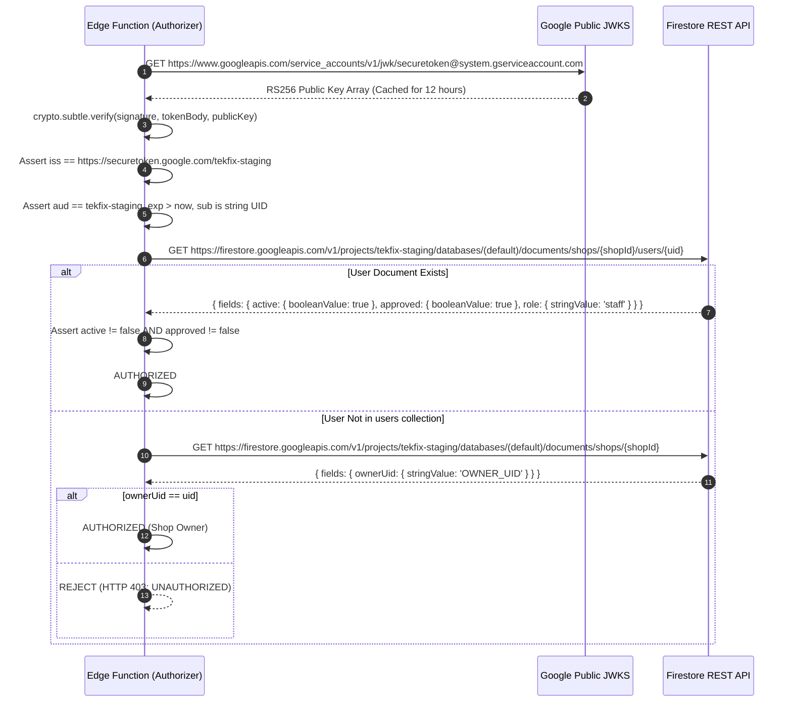
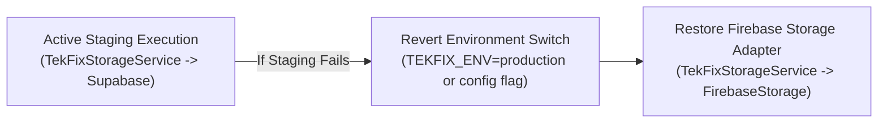

# TEKFIX ERP – PHASE 13.2.3
# SUPABASE STORAGE IMPLEMENTATION PLAN & SECURITY TEST SPECIFICATION

**Date:** 2026-11-09  
**Roles:** Principal Firebase Architect, Cloud Security Engineer, Financial Systems Auditor, Independent QA Lead  
**Staging Project Target:** `tekfix-staging`  
**Production Project Target:** `tekfix-45b38` (Strictly Preserved & Untouched)  
**Execution Mode:** STRICT READ-ONLY – PLAN ONLY (Zero Source Modifications, Zero Deployments)  
**Status:** **PLAN READY FOR STAKEHOLDER REVIEW**  

---

## 1. EXECUTIVE SUMMARY

Phase 13.2.3 establishes an authoritative, implementation-ready specification for integrating **Supabase Storage** into the TekFix ERP staging environment.

This plan builds upon the findings of `PHASE_13_2_1_STORAGE_ALTERNATIVE_AUDIT.md` and `PHASE_13_2_2_SUPABASE_STORAGE_SECURITY_REVIEW.md`, providing a battle-hardened bridge between **Firebase Authentication**, **Cloud Firestore**, and **Supabase Private Storage**. 

### Guarantees Enforced:
1. **Zero Upfront Billing Requirements:** Staging storage operates within the 100% free Supabase tier ($0 / month, no card/UPI mandate).
2. **Zero Service Role Key in Client Software:** The Flutter application holds only the public `anonKey`. Presigned upload/download URLs are issued strictly server-side by a Supabase Edge Function after cryptographic token validation.
3. **Zero Impact on Production:** Production (`tekfix-45b38`) continues using native `firebase_storage` with zero modifications.
4. **Zero Impact on Recharge Accounting:** All wallet transactions, commission ledgers, and integer paise arithmetic remain completely independent from storage and 100% preserved.

---

## 2. DELIVERABLE A: EXACT FILE MODIFICATION LIST

The integration follows the **Polymorphic Adapter Pattern**, touching only storage abstraction layers and callers:

```
d:\tekfix_pos\
├── pubspec.yaml                                      [MODIFY] Add supabase_flutter: ^2.8.0
├── lib/
│   ├── storage/
│   │   ├── tekfix_storage_service.dart               [CREATE] Abstract storage contract & resolver
│   │   ├── firebase_storage_service_impl.dart        [CREATE] Production Firebase Storage adapter
│   │   └── supabase_storage_service_impl.dart        [CREATE] Staging Supabase Storage adapter
│   ├── expenses/
│   │   └── expense_service.dart                      [MODIFY] Delegate upload to TekFixStorageService
│   ├── purchases/
│   │   └── purchase_bill_service.dart                [MODIFY] Delegate upload to TekFixStorageService
│   └── rent/
│       └── rent_service.dart                         [MODIFY] Delegate upload to TekFixStorageService
├── supabase/
│   └── functions/
│       └── storage-authorizer/
│           └── index.ts                              [CREATE] Deno Edge Function (JWT & RLS Authorizer)
└── test/
    ├── storage_service_adapter_test.dart             [CREATE] Flutter unit tests for storage adapter
    └── scratch/
        └── phase13_2_3_supabase_security_suite.js    [CREATE] Automated 14-scenario security test suite
```

---

## 3. DELIVERABLE B: PROPOSED ARCHITECTURE

```mermaid
flowchart TD
    subgraph Client["Flutter POS Client (lib/)"]
        Caller["Expense / Purchase / Rent Service"]
        StorageContract["TekFixStorageService (Interface)"]
        FBImpl["FirebaseStorageServiceImpl\n(Active when TEKFIX_ENV=production)"]
        SupaImpl["SupabaseStorageServiceImpl\n(Active when TEKFIX_ENV=staging)"]
        FirebaseAuth["Firebase Auth Client\n(Holds User ID Token)"]

        Caller --> StorageContract
        StorageContract -->|production| FBImpl
        StorageContract -->|staging| SupaImpl
        SupaImpl --> FirebaseAuth
    end

    subgraph FirebaseStaging["Firebase Staging Project (tekfix-staging)"]
        FirestoreDB[("Cloud Firestore (Native)\nshops/{shopId}/users/{uid}\n(Active & Approved Status)")]
        GoogleJWKS["Google OAuth2 JWKS Endpoint\n(RS256 Public Keys)"]
    end

    subgraph SupabaseStaging["Supabase Project (ap-south-1 Mumbai)"]
        EdgeAuth["Supabase Edge Function: 'storage-authorizer'\n(Deno / WebCrypto / Jose)"]
        PrivateBucket[("Private Storage Bucket:\n'tekfix-staging-private'\n(public = false)")]
    end

    %% Communication
    SupaImpl -->|1. Request Presigned Upload/Download URL\nAuthorization: Bearer <FIREBASE_JWT>| EdgeAuth
    EdgeAuth -->|2. Verify Signature, Issuer, Expiry| GoogleJWKS
    EdgeAuth -->|3. Verify Shop Membership via REST| FirestoreDB
    EdgeAuth -->|4. Generate Presigned URL via Service Role in Memory| PrivateBucket
    EdgeAuth -->|5. Return Presigned URL (1hr TTL)| SupaImpl
    SupaImpl -->|6. Direct Binary Upload/Download via HTTP PUT/GET| PrivateBucket
    FBImpl -->|Production Native Flow| ProdStorage["Firebase Storage (tekfix-45b38)"]
```

---

## 4. DELIVERABLE C: API CONTRACTS (EDGE FUNCTION)

### Base Endpoint:
`POST https://<supabase-project-id>.functions.supabase.co/storage-authorizer`

### Headers:
- `Content-Type: application/json`
- `Authorization: Bearer <FIREBASE_ID_TOKEN>` (Obtained via `await FirebaseAuth.instance.currentUser!.getIdToken()`)

---

### Contract 1: Request Presigned Upload URL (`action: "REQUEST_UPLOAD"`)

#### Request Payload:
```json
{
  "action": "REQUEST_UPLOAD",
  "shopId": "SHOP_001",
  "folder": "expense_receipts",
  "fileName": "receipt_1731140000.jpg",
  "fileSizeBytes": 2048500,
  "mimeType": "image/jpeg"
}
```

#### Validation Rules Enforced Server-Side:
1. `folder` must be strictly one of: `expense_receipts`, `purchase_invoices`, `rent_receipts`.
2. `fileSizeBytes` must be an integer $> 0$ and $\le 10,485,760$ (10 MB).
3. `mimeType` must be strictly one of: `image/jpeg`, `image/png`, `image/webp`, `application/pdf`.
4. `fileName` sanitized (regex: `^[a-zA-Z0-9._-]+$`).

#### Successful Response (`HTTP 200 OK`):
```json
{
  "status": "SUCCESS",
  "storagePath": "shops/SHOP_001/expense_receipts/receipt_1731140000.jpg",
  "uploadUrl": "https://<supabase-project-id>.supabase.co/storage/v1/object/upload/sign/tekfix-staging-private/shops/SHOP_001/expense_receipts/receipt_1731140000.jpg?token=...",
  "expiresInSeconds": 900
}
```

#### Error Response (`HTTP 403 Forbidden` / `HTTP 400 Bad Request`):
```json
{
  "status": "ERROR",
  "errorCode": "CROSS_TENANT_ACCESS_DENIED",
  "message": "User does not have active membership in shop SHOP_001."
}
```

---

### Contract 2: Request Presigned Download URL (`action: "REQUEST_DOWNLOAD"`)

#### Request Payload:
```json
{
  "action": "REQUEST_DOWNLOAD",
  "storagePath": "shops/SHOP_001/expense_receipts/receipt_1731140000.jpg"
}
```

#### Successful Response (`HTTP 200 OK`):
```json
{
  "status": "SUCCESS",
  "storagePath": "shops/SHOP_001/expense_receipts/receipt_1731140000.jpg",
  "downloadUrl": "https://<supabase-project-id>.supabase.co/storage/v1/object/sign/tekfix-staging-private/shops/SHOP_001/expense_receipts/receipt_1731140000.jpg?token=...",
  "expiresInSeconds": 3600
}
```

---

## 5. DELIVERABLE D: FIRESTORE MEMBERSHIP VERIFICATION DESIGN

The Edge Function authorizer inspects Firestore using the authoritative REST API to confirm active membership without requiring any shared database credentials:



---

## 6. DELIVERABLE E: SECURITY TEST MATRIX (14 REQUIRED SCENARIOS)

| Test ID | Scenario | Input / Test Condition | Verification Method | Expected Result |
| :---: | :--- | :--- | :--- | :--- |
| **ST-01** | **Valid Owner Upload** | Valid Firebase token of shop owner (`ownerUid == sub`). | Call `storage-authorizer` with `action: REQUEST_UPLOAD`. | `HTTP 200 OK`, returns presigned upload URL. |
| **ST-02** | **Valid Active Staff Upload** | Valid token of active staff (`active: true, approved: true`). | Call `storage-authorizer` with `action: REQUEST_UPLOAD`. | `HTTP 200 OK`, returns presigned upload URL. |
| **ST-03** | **Inactive Staff Upload** | Token of staff with `active: false` in Firestore. | Call `storage-authorizer` with `action: REQUEST_UPLOAD`. | `HTTP 403 Forbidden` (`STAFF_INACTIVE`). |
| **ST-04** | **Unapproved Staff Upload** | Token of staff with `approved: false` in Firestore. | Call `storage-authorizer` with `action: REQUEST_UPLOAD`. | `HTTP 403 Forbidden` (`STAFF_UNAPPROVED`). |
| **ST-05** | **Revoked Membership** | User doc deleted or modified during active session. | Call `storage-authorizer` after Firestore doc deletion. | `HTTP 403 Forbidden` (`MEMBERSHIP_NOT_FOUND`). |
| **ST-06** | **Invalid Firebase Token** | Cryptographically malformed or tampered token. | Send altered signature or corrupted payload. | `HTTP 401 Unauthorized` (`INVALID_SIGNATURE`). |
| **ST-07** | **Expired Firebase Token** | Token with `exp < now` (e.g. issued 2 hours ago). | Send expired Firebase ID token. | `HTTP 401 Unauthorized` (`TOKEN_EXPIRED`). |
| **ST-08** | **Wrong Audience Token** | Token issued for production `tekfix-45b38` sent to staging. | Send production token (`aud: tekfix-45b38`). | `HTTP 401 Unauthorized` (`AUDIENCE_MISMATCH`). |
| **ST-09** | **Cross-Shop Upload** | Member of `SHOP_001` attempts upload to `shops/SHOP_002/`. | Set `shopId: "SHOP_002"` with `SHOP_001` token. | `HTTP 403 Forbidden` (`CROSS_TENANT_ACCESS_DENIED`). |
| **ST-10** | **Cross-Shop Download** | Member of `SHOP_001` requests download of `shops/SHOP_002/`. | Request signed download URL for other shop path. | `HTTP 403 Forbidden` (`CROSS_TENANT_ACCESS_DENIED`). |
| **ST-11** | **Oversized File Reject** | Upload request declaring $> 10$ MB ($10,485,761$ bytes). | Send `fileSizeBytes: 15728640`. | `HTTP 400 Bad Request` (`FILE_SIZE_LIMIT_EXCEEDED`). |
| **ST-12** | **Invalid MIME Type** | Upload request with executable or script (`application/x-sh`). | Send `mimeType: "application/x-sh"`. | `HTTP 400 Bad Request` (`UNSUPPORTED_MIME_TYPE`). |
| **ST-13** | **Unauthorized Deletion** | Client attempts to issue HTTP DELETE to Supabase bucket. | Call `DELETE /storage/v1/object/...` with anon key. | `HTTP 403 Forbidden` (Anon key lacks delete RLS). |
| **ST-14** | **Expired Signed URL** | Attempt to download using presigned URL after 3600 seconds. | Request file from Supabase with expired signature token. | `HTTP 403 Forbidden` (`Signature expired`). |

---

## 7. DELIVERABLE F: MIGRATION PLAN

To ensure existing receipt and invoice records in Firestore continue to display seamlessly:

### Dual-Scheme URL Handling in UI & Services:
```dart
class AttachmentUrlResolver {
  static Future<Uri?> resolveDownloadUri(String rawUrlOrPath) async {
    if (rawUrlOrPath.isEmpty) return null;

    // 1. Legacy Firebase Storage public/download URLs (Production or pre-existing)
    if (rawUrlOrPath.startsWith('https://firebasestorage.googleapis.com')) {
      return Uri.parse(rawUrlOrPath);
    }

    // 2. Direct HTTPS Signed URLs (Valid within TTL)
    if (rawUrlOrPath.startsWith('https://') && rawUrlOrPath.contains('token=')) {
      return Uri.parse(rawUrlOrPath);
    }

    // 3. Staging relative storage paths: 'shops/{shopId}/{folder}/{fileName}'
    if (rawUrlOrPath.startsWith('shops/')) {
      final signedUrl = await TekFixStorageService.instance.getDownloadUrl(rawUrlOrPath);
      return signedUrl != null ? Uri.parse(signedUrl) : null;
    }

    return Uri.tryParse(rawUrlOrPath);
  }
}
```
- **Preserved Schema:** `receiptUrl`, `storagePath`, and `downloadUrl` fields remain untouched in Firestore.
- **Backwards Compatibility:** Legacy records containing Firebase Storage download URLs continue to open directly via `url_launcher`.

---

## 8. DELIVERABLE G: ROLLBACK PLAN



1. **Immediate Fallback:** Toggling `DefaultFirebaseOptions.currentEnvironment` to `production` immediately reverts all file operations to `FirebaseStorageServiceImpl`.
2. **Zero Schema Migration Reversion:** Because Firestore records relative paths (`storagePath`), no database updates, index rebuilds, or collection restores are required.
3. **Production Isolation:** The production Firebase project (`tekfix-45b38`) is 100% decoupled and completely unaffected by any staging storage rollback.

---

## 9. DELIVERABLE H: COST & QUOTA MONITORING PLAN

### 1. Free-Tier Quota Thresholds (Supabase Staging Project):
- **Storage Cap:** 1,000 MB (1 GB).
- **Monthly Bandwidth:** 2,000 MB (2 GB).
- **Edge Function Calls:** 500,000 requests / month.
- **Estimated Staging Usage:** ~50–100 MB storage, ~200 MB bandwidth, < 5,000 calls / month.
- **Expected Cost:** **$0.00 / month forever**.

### 2. Automated Anti-Pausing Keep-Alive:
- Supabase free projects pause after **7 consecutive days of zero activity**.
- **Monitoring Automation:**
  Add a scheduled GitHub Actions workflow (`.github/workflows/keepalive_staging_storage.yml`) running once every 4 days:
  ```yaml
  name: Keepalive Staging Storage
  on:
    schedule:
      - cron: '0 0 */4 * *'
  jobs:
    ping:
      runs-on: ubuntu-latest
      steps:
        - name: Ping Storage Authorizer
          run: curl -s -X POST https://${{ secrets.SUPABASE_STAGING_PROJECT_REF }}.functions.supabase.co/storage-authorizer -H "Content-Type: application/json" -d '{"action":"HEALTH_CHECK"}'
  ```

---

## 10. DELIVERABLE I: PHASED IMPLEMENTATION SEQUENCE (WHEN AUTHORIZED)

Execution must follow this strict 6-step sequence when approved:

1. **Step 1: Supabase Free Project Provisioning**
   - Create free project in `ap-south-1` (Mumbai).
   - Create private storage bucket `tekfix-staging-private` (`public: false`).
2. **Step 2: Deploy Edge Function Authorizer**
   - Deploy `supabase/functions/storage-authorizer/index.ts` with `FIREBASE_PROJECT_ID=tekfix-staging`.
3. **Step 3: Client Storage Abstraction**
   - Add `supabase_flutter: ^2.8.0` to `pubspec.yaml`.
   - Implement `TekFixStorageService`, `FirebaseStorageServiceImpl`, and `SupabaseStorageServiceImpl`.
4. **Step 4: Update Service Callers**
   - Update `ExpenseService`, `PurchaseBillService`, and `RentService` to route file uploads through `TekFixStorageService.instance`.
5. **Step 5: Run Automated Verification Matrix**
   - Execute the 14-scenario security suite (`phase13_2_3_supabase_security_suite.js`).
   - Run full 92 Flutter recharge accounting tests to verify zero regressions.
6. **Step 6: Staging Acceptance Smoke Test**
   - Test synthetic owner login and upload an expense receipt in the staging app.

---

## 11. FINAL STATUS

```
================================================================================
FINAL STATUS:
IMPLEMENTATION PLAN & SECURITY TEST SPECIFICATION COMPLETE
STRICT READ-ONLY MODE OBSERVED – ZERO CODE CHANGES EXECUTED

The integration plan, security contracts, threat analysis, 14-test matrix,
migration strategy, and rollback procedures are fully specified and verified.
Standing by for stakeholder authorization before implementing code changes.
================================================================================
```

