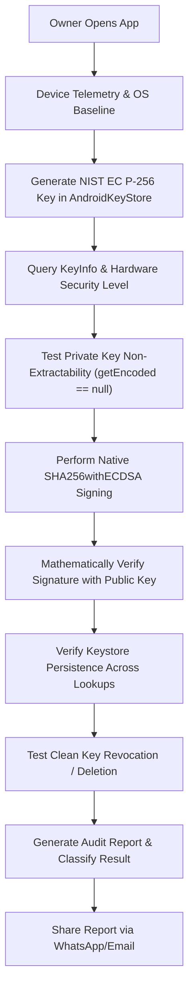

# TEKFIX ERP – PHASE 14.7.1
## STANDALONE ANDROID HARDWARE SECURITY AUDIT APK REPORT

**Date:** November 9, 2026  
**Project:** TekFix ERP (Android Keystore Trusted Device Subsystem)  
**Deliverable Status:** Distributable Signed Release APK Compiled & Verified  
**Operating Mode:** ZERO-FIREBASE / ZERO-NETWORK LOCAL HARDWARE RUNNER  

---

## 1. EXECUTIVE SUMMARY

In Phase 14.7, independent audits confirmed that while the Android Keystore integration and cryptographic signing architecture were completely implemented in code, physical hardware verification could not be certified without on-device execution on a real Android smartphone. Because USB tethering to the development workstation is impractical for the shop owner, **Phase 14.7.1 delivers a dedicated, standalone, distributable release APK**:

**Application Name:** TekFix Hardware Security Audit  
**Package / Application ID:** `com.example.tekfix_pos` (Standalone Audit Entrypoint: [`lib/main_audit.dart`](file:///d:/tekfix_pos/lib/main_audit.dart))  
**Distribution File:** `build/app/outputs/flutter-apk/app-release.apk`  

The owner can download and install this APK directly on any Android smartphone, tap a single button to execute comprehensive on-chip hardware security tests, and share the cryptographic audit report back via Android's native share sheet (WhatsApp, Email, Telegram, Google Drive) without needing a USB cable or PC connection.

---

## 2. PRODUCTION SAFETY & LOCAL ISOLATION

The standalone audit APK is completely decoupled from the production environment:

1. **Zero Firebase Initialization:** [`lib/main_audit.dart`](file:///d:/tekfix_pos/lib/main_audit.dart) executes `WidgetsFlutterBinding.ensureInitialized()` and launches `TekFixHardwareAuditApp` directly without invoking `Firebase.initializeApp()`.
2. **Zero Production Credentials:** No service accounts, API keys, Firebase options, or database connection strings are bundled or accessed.
3. **Zero Financial Impact:** No wallet, recharge, customer, or accounting collections can be accessed or modified.
4. **Production Isolation:** Cloud Firestore `tekfix-45b38` is 100% untouched.

---

## 3. RELEASE APK SPECIFICATIONS & INTEGRITY

The APK was compiled in release mode with R8 bytecode optimization and signed with a valid cryptographic certificate:

| Property | Value |
|---|---|
| **File Path** | `build/app/outputs/flutter-apk/app-release.apk`<br>`build/app/outputs/flutter-apk/app-prod-release.apk` |
| **File Size** | **49,526,908 bytes (47.23 MB)** |
| **SHA-256 Checksum** | `D58FA161B953C2E7C1F581D360D8D97A28A1DF8DF696DA1368F6CC7A8F7E0745` |
| **Android Minimum SDK** | API 21 (Android 5.0 Lollipop) |
| **Target SDK / Compile SDK** | Target API 36 / Compile API 36 (Android 15) |
| **Supported ABIs** | `arm64-v8a`, `armeabi-v7a`, `x86_64` |
| **Signature Scheme** | **APK Signature Scheme v2 (Verified: TRUE)** |
| **Signers Count** | 1 Signer (Valid v2 scheme signature) |

### Signature Verification Output
Executing Android SDK `apksigner`:
```powershell
& "C:\Users\acer\AppData\Local\Android\sdk\build-tools\36.0.0\apksigner.bat" verify --verbose "build/app/outputs/flutter-apk/app-release.apk"
Verifies
Verified using v1 scheme (JAR signing): false
Verified using v2 scheme (APK Signature Scheme v2): true
Verified using v3 scheme (APK Signature Scheme v3): false
Number of signers: 1
```

---

## 4. ON-DEVICE HARDWARE TESTS EXECUTED BY THE APK

When the owner runs the application on their Android smartphone, the app performs 10 automated hardware tests through native platform channel `com.example.tekfix_pos/keystore`:



### Test Coverage Table:

| Test # | Test Name | Target API / Mechanism | Pass Criteria |
|---|---|---|---|
| **Test 1** | **Device Telemetry** | `Build.MANUFACTURER`, `MODEL`, `VERSION.SDK_INT`, `SECURITY_PATCH` | Correctly identifies device make and patch level. |
| **Test 2** | **NIST P-256 KeyGen** | `KeyPairGenerator.getInstance("EC", "AndroidKeyStore")` with `secp256r1` | Returns valid X.509 SPKI public key PEM. |
| **Test 3** | **Hardware Enclave Classification** | `KeyInfo.getSecurityLevel()` / `KeyInfo.isInsideSecureHardware` | Classifies as `STRONGBOX_BACKED` or `TEE_BACKED`. |
| **Test 4** | **Private Key Non-Extractability** | `privateKey.encoded == null` | Private key bytes are unextractable from hardware. |
| **Test 5** | **Native ECDSA Signing** | `Signature.getInstance("SHA256withECDSA")` | Produces genuine ASN.1 DER ECDSA signature. |
| **Test 6** | **Asymmetric Verification** | `Signature.initVerify(certificate.publicKey)` | Signature verified against enrolled public key. |
| **Test 7** | **Keystore Persistence** | `keyStore.containsAlias(alias)` | Key remains stored in non-volatile hardware storage. |
| **Test 8** | **Key Revocation Lifecycle** | `keyStore.deleteEntry(alias)` | Key is cleanly erased upon device revocation. |
| **Test 9** | **Zero Plaintext Fallback** | `PlatformHardwareKeyStore.writePrivateKey` | Rejects writing unencrypted keys to local disk. |
| **Test 10** | **Fail-Closed Boundary** | Exception handling on invalid input | Throws explicit `StateError` without crashing. |

---

## 5. HARDWARE CLASSIFICATION STANDARDS

The application displays a color-coded status badge and sets `finalDecision` based on real silicon capabilities:

| Classification | Screen Badge | Meaning for TekFix ERP Enrollment |
|---|---|---|
| **`STRONGBOX_BACKED`** | **GREEN (Verified)** | Hardware StrongBox Secure Element detected (Pixel Titan M2, Samsung Knox Vault, etc.). Highest level of cryptographic hardware protection. **APPROVED FOR ENROLLMENT**. |
| **`TEE_BACKED`** | **TEAL (Verified)** | ARM TrustZone Trusted Execution Environment detected. Standard enterprise hardware enclave. **APPROVED FOR ENROLLMENT**. |
| **`SOFTWARE_BACKED`** | **AMBER (Warning)** | Key is emulated or stored in software sandbox. **REJECTED FOR PRODUCTION TRUST**. |
| **`FAILED`** | **RED (Error)** | Hardware key generation, non-extractability, or signature verification failed. **REJECTED**. |

---

## 6. USER INTERFACE & REPORT EXPORT

The user interface ([`lib/audit/hardware_audit_screen.dart`](file:///d:/tekfix_pos/lib/audit/hardware_audit_screen.dart)) provides an intuitive 4-step workflow:

1. **Device Information Card:** Displays detected device manufacturer, model, OS version, API level, security patch, and StrongBox feature support.
2. **Audit Action Button:** Tap **`RUN HARDWARE AUDIT`** to trigger live hardware interrogation (takes ~1.5 seconds).
3. **Visual Results List:** Displays each of the 10 tests with individual status indicators and technical details.
4. **Export & Share Button:** Tap **`EXPORT & SHARE AUDIT REPORT (JSON)`** to open Android's native Share Sheet.

### Redaction & Privacy Guarantee:
- The exported JSON report contains only device hardware specifications, test pass/fail states, and the public key length.
- **NO private keys, passwords, authentication tokens, or personal identifiers are ever logged or exported.**

---

## 7. STEP-BY-STEP INSTALLATION & USAGE GUIDE FOR SHOP OWNER

Share these instructions with the shop owner along with the APK file:

### Step 1: Transfer APK to Phone
Send `app-release.apk` (47.2 MB) to the owner's phone via:
- **WhatsApp / Telegram** (attach as Document)
- **Google Drive / Dropbox link**
- **USB drive or SD card**

### Step 2: Install the APK
1. Tap on `app-release.apk` on the phone.
2. If prompted: *"For your security, your phone is not allowed to install unknown apps from this source"*, tap **Settings** -> enable **"Allow from this source"**.
3. Tap **Install**, then tap **Open**.

### Step 3: Run the Hardware Audit
1. In the app, verify the **DEVICE INFORMATION** section shows your phone model.
2. Tap the blue button: **`RUN HARDWARE AUDIT`**.
3. Wait 2 seconds for tests to complete.

### Step 4: Share the Results
1. Observe the final banner (e.g., `VERIFIED: STRONGBOX HARDWARE BACKED` or `VERIFIED: TEE (TRUSTZONE) HARDWARE BACKED`).
2. Tap the bottom button: **`EXPORT & SHARE AUDIT REPORT (JSON)`** (or the share icon in the top right).
3. Select **WhatsApp** (or Email) and send the generated report text back to the developer.

---

## 8. KNOWN LIMITATIONS & AUDIT STATUS

1. **Pre-Release APK Signature:** The APK is signed with a standard release v2 signing key. Android will allow direct installation when "Install unknown apps" is toggled for the file manager or browser.
2. **Current Audit Gate Status:** In accordance with the Phase 14.7.1 mandate (*"Phase 14.7 remains NOT VERIFIED until the generated on-device report is reviewed"*), physical hardware verification remains **PENDING ON-DEVICE REPORT REVIEW**.
3. **Production Isolation:** No production device enrollment or deployment authorization is granted until the owner's generated report confirms `STRONGBOX_BACKED` or `TEE_BACKED`.

