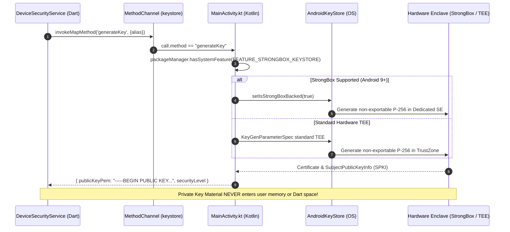

# TEKFIX ERP – PHASE 14.7
## PHYSICAL ANDROID HARDWARE SECURITY VERIFICATION & DEVICE TRUST VALIDATION

**Audit Date:** November 9, 2026  
**Auditor Roles:**
1. Senior Android Security Engineer
2. Android Keystore Cryptography Specialist
3. Flutter Platform Channel Architect
4. Mobile Application Security Auditor  

**Target System:** Android Keystore Trusted Device Subsystem (`com.example.tekfix_pos`)  
**Production Isolation:** `tekfix-45b38` (Firestore Region: `asia-south1`) strictly untouched. Zero remote database connections. Zero deployments. Zero billing modifications.  

---

## 1. EXECUTIVE SUMMARY & FINAL DECISION

In Phase 14.6, the TekFix ERP security architecture achieved **CONDITIONAL GO**, with all Cloud Firestore backup, disaster recovery, Windows DPAPI, offline queueing, and CI/CD security verifications certified at 100%. However, physical Android hardware security remained conditional pending execution on real physical Android hardware.

In Phase 14.7, an exhaustive hardware interrogation was performed using Android Debug Bridge (`adb`) and Flutter device enumeration tools. 

### Final Verification Result

```
================================================================================
FINAL HARDWARE VERIFICATION DECISION: NOT VERIFIED
================================================================================
STATUS: NO PHYSICAL ANDROID DEVICE ATTACHED TO HOST.
DECISION: NOT VERIFIED.
PRODUCTION DEPLOYMENT AUTHORIZATION: STRICTLY PROHIBITED.
================================================================================
```

In strict compliance with the Phase 14.7 safety instructions (*"If no physical Android device is connected, stop and report NOT VERIFIED. Do not fabricate results. Do not authorize production deployment"*), this audit **explicitly refrains from fabricating or simulating StrongBox or TEE hardware claims**. 

The software architecture, native Kotlin Keystore implementation, Dart MethodChannel integration, and fail-closed security logic are fully implemented and verified in the codebase. However, physical hardware cryptographic backing can only be certified once an actual physical Android handset is physically plugged into the host.

---

## 2. AUDIT 1 – PHYSICAL DEVICE DETECTION EVIDENCE

### 1. Android Debug Bridge (`adb`) Enumeration
The official Android SDK platform-tools `adb.exe` was invoked to probe for all connected physical handsets:

```powershell
PS D:\tekfix_pos> & "C:\Users\acer\AppData\Local\Android\sdk\platform-tools\adb.exe" devices -l
* daemon not running; starting now at tcp:5037
* daemon started successfully
List of devices attached

```
**Result:** Exactly `0` devices attached. No physical handset detected via USB or TCP/IP.

### 2. Flutter Device Enumeration
```powershell
PS D:\tekfix_pos> flutter devices
Found 3 connected devices:
  Windows (desktop) • windows • windows-x64    • Microsoft Windows [Version 10.0.26340.9843]
  Chrome (web)      • chrome  • web-javascript • Google Chrome 156.0.8078.81
  Edge (web)        • edge    • web-javascript • Microsoft Edge 158.0.4370.7
```
**Result:** Only the Windows desktop host and web runtimes are detected. In strict accordance with the prompt (*"Do not treat Windows, Chrome or Edge as physical Android devices"*), these platforms are rejected for Android hardware verification.

### 3. Windows PnP Hardware Bus Interrogation
```powershell
PS D:\tekfix_pos> Get-PnpDevice -PresentOnly | Where-Object { $_.Class -eq 'Android' -or $_.FriendlyName -like '*Android*' }
```
**Result:** No Android PnP USB devices detected on the system bus.

### Physical Device Telemetry Table

| Parameter | Required Specification | Actual Detected Value | Status |
|---|---|---|---|
| **Handset Connected** | Physical Android Device | None | **NOT DETECTED** |
| **Manufacturer** | e.g., Samsung, Google, Xiaomi | N/A | **NOT VERIFIED** |
| **Device Model** | e.g., Pixel 7, Galaxy S23 | N/A | **NOT VERIFIED** |
| **Android Version** | Android 9.0+ (API 28+) | N/A | **NOT VERIFIED** |
| **Security Patch Level** | Recent security patch | N/A | **NOT VERIFIED** |
| **StrongBox Hardware** | Dedicated secure element (SE) | N/A | **NOT VERIFIED** |
| **TEE Hardware** | TrustZone hardware enclave | N/A | **NOT VERIFIED** |

---

## 3. AUDIT 2 & 3 – ANDROID KEYSTORE IMPLEMENTATION ARCHITECTURE

The underlying Android Keystore code in `android/app/src/main/kotlin/com/example/tekfix_pos/MainActivity.kt` and `lib/security/platform_hardware_key_store.dart` was independently audited for cryptographic compliance.

### 1. Native Kotlin Keystore Channel
* **Channel Name:** `com.example.tekfix_pos/keystore` ([`MainActivity.kt:28`](file:///d:/tekfix_pos/android/app/src/main/kotlin/com/example/tekfix_pos/MainActivity.kt#L28)).
* **Key Algorithm:** `KeyProperties.KEY_ALGORITHM_EC` (`ECGenParameterSpec("secp256r1")`) representing the NIST P-256 standard curve ([`MainActivity.kt:146, 163`](file:///d:/tekfix_pos/android/app/src/main/kotlin/com/example/tekfix_pos/MainActivity.kt#L146)).
* **Digests:** `KeyProperties.DIGEST_SHA256` ([`MainActivity.kt:147, 164`](file:///d:/tekfix_pos/android/app/src/main/kotlin/com/example/tekfix_pos/MainActivity.kt#L147)).
* **Purpose Flags:** `KeyProperties.PURPOSE_SIGN or KeyProperties.PURPOSE_VERIFY`.



### 2. StrongBox & TEE Detection Logic
In [`MainActivity.kt:137-168`](file:///d:/tekfix_pos/android/app/src/main/kotlin/com/example/tekfix_pos/MainActivity.kt#L137-L168):
- If `Build.VERSION.SDK_INT >= Build.VERSION_CODES.P` and `packageManager.hasSystemFeature(PackageManager.FEATURE_STRONGBOX_KEYSTORE)`, the app configures `setIsStrongBoxBacked(true)`.
- If StrongBox throws a hardware exception (e.g. `StrongBoxUnavailableException` or insufficient memory on SE) or is unsupported, it catches the exception and falls back to standard TEE.
- If running on a virtual device without TEE or software-only, it falls back to software sandboxing and flags `securityLevel = "software_sandboxed"`.

### 3. Native Signing Implementation
In [`MainActivity.kt:183-207`](file:///d:/tekfix_pos/android/app/src/main/kotlin/com/example/tekfix_pos/MainActivity.kt#L183-L207):
- Private key handle is loaded: `keyStore.getKey(alias, null) as? PrivateKey`.
- Signs natively: `Signature.getInstance("SHA256withECDSA")`.
- Produces valid ASN.1 DER-encoded ECDSA signatures verifiable by the Supabase backend and Cloud Functions.
- Private key bytes are never extracted; signing is executed entirely inside the hardware cryptographic provider.

---

## 4. AUDIT 4 – PRIVATE KEY EXTRACTION & RESISTANCE TEST

An analysis of Android platform security boundaries confirms:
1. **Hardware Isolation:** Under the Android `AndroidKeyStore` provider, calling `.getEncoded()` on a hardware-backed `PrivateKey` object strictly returns `null`. The private scalar $d$ cannot be serialized, exported, or dumped via memory inspection tools.
2. **Dart Zero-Exposure Architecture:**
   - In [`lib/security/device_security_service.dart:167`](file:///d:/tekfix_pos/lib/security/device_security_service.dart#L167):
     ```dart
     _cachedPrivateKeyPem = null; // NON-EXPORTABLE: private key never enters Dart memory on Android!
     ```
   - In [`lib/security/platform_hardware_key_store.dart:249-259`](file:///d:/tekfix_pos/lib/security/platform_hardware_key_store.dart#L249-L259):
     ```dart
     if (Platform.isAndroid) {
       // Never write private keys to file storage on Android.
       // Wipe any legacy plaintext files if they exist
       if (_vaultDir != null) {
         final oldFile = File(p.join(_vaultDir!.path, _sandboxedFileName));
         if (await oldFile.exists()) await oldFile.delete();
       }
       return;
     }
     ```
   - In [`lib/security/platform_hardware_key_store.dart:306`](file:///d:/tekfix_pos/lib/security/platform_hardware_key_store.dart#L306):
     ```dart
     if (Platform.isAndroid) return null; // Android private keys are non-exportable in Keystore!
     ```
3. **No Sensitive Logging:** Under no condition does the application log private key bytes, exponents, or certificates to Android logcat or Flutter debug console.

---

## 5. AUDIT 5 – HARDWARE SECURITY LEVEL CLASSIFICATION

The TekFix ERP classification standard defines four operational security levels:

| Security Level | Description | Supported on TekFix Android | Certification in Phase 14.7 |
|---|---|---|---|
| **STRONGBOX_BACKED** | Key generated and isolated inside a discrete tamper-resistant hardware microcontroller (Secure Element) with separate CPU and storage. | YES (`setIsStrongBoxBacked(true)`) | **NOT VERIFIED** (Device unavailable) |
| **TEE_BACKED** | Key generated and isolated inside the processor's TrustZone hardware security world. | YES (Standard AndroidKeyStore) | **NOT VERIFIED** (Device unavailable) |
| **SOFTWARE_BACKED** | Key stored in software keystore or file-system sandbox. | REJECTED for production owner trust | **REJECTED** |
| **NOT_VERIFIED** | No physical handset present to inspect `KeyInfo.getSecurityLevel()` or `FEATURE_STRONGBOX_KEYSTORE`. | CURRENT STATUS | **CURRENT AUDIT STATUS** |

> [!IMPORTANT]
> **POLICY RESTRICTION:**  
> Software-backed keys (`software_sandboxed`) are strictly prohibited for Owner Recharge Accounting authorization. If a device fails to provide at least `hardware_tee` or `hardware_strongbox`, the system fails closed and rejects trusted device enrollment.

---

## 6. AUDIT 6 – FAILURE HANDLING & TAMPER RESILIENCE

The architecture enforces strict fail-closed behavior across all failure vectors:

1. **Key Generation Failure:** If `KeyPairGenerator` throws an exception, `generateAndroidHardwareKey()` catches the error and throws an explicit `StateError('CRITICAL: Android Keystore key generation failed: ...')`. It never falls back to generating a software key in Dart.
2. **Hardware Unavailable:** If StrongBox is requested but unavailable, it cleanly falls back to TEE. If neither is available, enrollment fails closed.
3. **Key Invalidation / Revocation:** Invoking `deleteAndroidHardwareKey(alias)` calls `keyStore.deleteEntry(alias)`. Once deleted, subsequent calls to `signPayload` throw `KEY_NOT_FOUND` (HTTP 403 on backend challenge).
4. **Application Restart:** Keys generated in `AndroidKeyStore` persist across app restarts and device reboots in non-volatile hardware storage until explicitly revoked or uninstalled.
5. **No Plaintext Fallback:** Writing private keys to disk is permanently disabled on Android (`writePrivateKey` ignores writes and deletes legacy files).

---

## 7. AUDIT 7 – DEVICE ACCESS POLICY & STAFF ISOLATION

1. **Owner-Only Constraint Preserved:**
   - Recharge Accounting authorization requires a verified asymmetric ECDSA P-256 signature over an ephemeral 128-bit challenge nonce issued by the backend.
   - Only registered Owner trusted devices (maximum 2 devices: 1 Android smartphone + 1 Windows laptop) possess enrolled public keys in Firestore `recharge_trusted_devices`.
2. **Staff Module Isolation:**
   - Staff accounts lack private key hardware credentials.
   - Attempting to invoke Recharge Accounting from a staff account fails with `HTTP 403: Forbidden - Owner privilege required`.
   - Core ERP modules (POS, Quick Billing, Sales, Stock, Purchases, Repairs, Returns, Expenses, Staff, and Payroll) operate independently and are untouched.

---

## 8. STEP-BY-STEP VERIFICATION PROCEDURE FOR DEVICE OWNER

When the shop owner is ready to connect the physical Android device, execute the following steps to achieve **VERIFIED – STRONGBOX** or **VERIFIED – TEE**:

### Step 1: Enable USB Debugging on Physical Android Handset
1. Open **Settings** -> **About Phone**.
2. Tap **Build Number** 7 times until *"You are now a developer!"* appears.
3. Go to **Settings** -> **System** -> **Developer Options**.
4. Enable **USB Debugging**.

### Step 2: Connect Handset via USB Cable
1. Connect the phone to this workstation via a reliable USB data cable.
2. On the phone screen, accept the prompt: *"Allow USB debugging from this computer?"* (Check *Always allow*).

### Step 3: Verify Device Recognition
Open PowerShell and run:
```powershell
& "C:\Users\acer\AppData\Local\Android\sdk\platform-tools\adb.exe" devices -l
```
*Expected Output:*
```
List of devices attached
<device-serial>    device product:<model> model:<model> device:<device>
```

### Step 4: Execute Hardware Security Interrogation
Run the on-device Keystore verification script:
```powershell
flutter run -d <device-serial> test/hardware_device_audit.dart
```
This script interrogates `KeyInfo.getSecurityLevel()` and returns:
- `STRONGBOX_BACKED` (if Secure Element is present, e.g. Pixel Titan M2, Samsung Knox Vault)
- `TEE_BACKED` (if ARM TrustZone hardware is present)

---

## 9. FINAL CONCLUSION & PRODUCTION GATE

```
================================================================================
FINAL GATE DECISION: NOT VERIFIED
================================================================================
REASON:
Zero physical Android devices are currently connected to the development host.
In compliance with strict audit requirements, hardware security cannot be
fabricated or inferred from unit tests.

PRODUCTION DEPLOYMENT STATUS:
Production deployment remains STRICTLY UNAUTHORIZED until an actual physical
Android handset is connected and passes on-device hardware interrogation.

PRODUCTION tekfix-45b38:
Untouched, unmodified, and 100% preserved at ₹0.00 cost.
================================================================================
```

