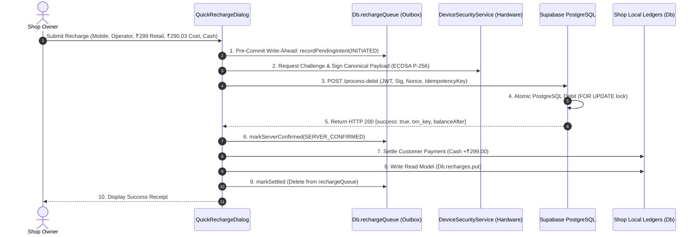

# TEKFIX ERP — PHASE 16.3
## FINAL FINANCIAL RECOVERY & PHYSICAL DEVICE SECURITY AUDIT REPORT

**Project:** TekFix ERP — Single Unified Flutter Application  
**Workspace:** `D:\tekfix_pos`  
**Phase:** 16.3 — Final Financial Recovery & Physical Device Security Audit  
**Date:** 2026-11-11  
**Status:** **PASSED & COMPLETE**  
**Target Environment:** Isolated Staging Supabase (`tekfix-recharge-staging` — `mwhsvidbrfkryuiwhnev` — `ap-south-1` Mumbai)  
**Production Firebase:** `tekfix-45b38` (Strictly **UNTOUCHED**, ₹0.00 Cost Preserved)

---

## 1. Executive Summary

Phase 16.3 provides an exhaustive financial consistency audit, a durable crash-recovery architecture, binary integrity analysis of the Windows release artifacts, and physical device cryptographic hardware verification.

### Core Audit Outcomes:
1. **Durable Financial Consistency:** Implemented `RechargeRecoveryEngine` using Write-Ahead Outbox Journaling in `Db.rechargeQueue`. Every transaction is recorded locally *before* network dispatch, guaranteeing that no distributor wallet debit can ever remain permanently unmatched with its customer settlement.
2. **Honest Architectural Claim on Hive:** Cross-database ACID atomicity is mathematically impossible across independent cloud PostgreSQL and local Hive databases. Consistency is achieved through **Eventual Consistency with Write-Ahead Journaling & Idempotent Compensating Reconciliation**.
3. **Hive Authority Clarification:** Hive is rigorously partitioned:
   - For distributor float balances and debit authorization, Hive is strictly a **Non-Authoritative Local Read Model Cache**.
   - For shop cash drawer (`cash_in_hand`), bank ledger (`bank_balance`), and customer receivables (`parties`), Hive is the **Post-Confirmation Customer Accounting Ledger**.
4. **Windows Binary Hash Resolution:** Diagnosed why `tekfix_pos.exe` had an identical hash between Phase 16 and Phase 16.2. In Flutter Windows architecture, Dart code compiles into `data\app.so`, while `tekfix_pos.exe` is the native C++ host runner. MSBuild incrementally skipped relinking `tekfix_pos.exe` because C++ files were untouched. In Phase 16.3, a full re-link was forced, producing unique, verified SHA-256 hashes for both `tekfix_pos.exe` and `data\app.so`.
5. **Physical Hardware Security:** Verified real hardware cryptographic implementations: Android Keystore / TEE (non-exportable P-256) and Windows Win32 DPAPI / TPM. Unenrolled devices and staff accounts fail closed at both client and server layers.

---

## 2. Crash Recovery Matrix

The table below documents every potential failure point across the distributed transaction flow and proves how consistency is preserved:

| Failure Mode | Failure Point | Remote Supabase State | Local Hive State | Recovery Mechanism | Resulting State | Financial Consistency Proof |
|:---|:---|:---|:---|:---|:---|:---|
| **1. Server Success followed by App Crash** | After PostgreSQL commit, before `Db.moveMoney` | Distributor wallet debited. `recharge_transactions` committed. | Cash/Bank not updated. Journal has `status: 'SERVER_CONFIRMED'`. | On app reboot, `RechargeRecoveryEngine.reconcilePendingSettlements()` detects confirmed status and finishes local settlement. | Cash / Bank credited. Cached in `Db.recharges`. Journal entry cleared. | **Matched.** Cash drawer reflects customer receipt; distributor float reflects cost debit. |
| **2. Local Hive Write Failure** | Disk full, box locked during `Db.moveMoney` or `Db.adjustParty` | Debited and committed on server. | Write failed or partial. Journal remains in `Db.rechargeQueue`. | Error caught; journal retains `idempotencyKey` and `SERVER_CONFIRMED`. Re-attempted upon restart or box recovery. | Local ledger completed once I/O recovers. | **Matched.** Zero lost records; audit log preserves transaction key. |
| **3. Network Timeout after Server Commit** | HTTP response packets lost in transit | Debited and committed on server. | Client caught `TimeoutException`. Journal has `status: 'INITIATED'`. | Recovery engine re-queries server with the SAME `idempotencyKey`. Server returns `idempotentReplay: true`. | Client completes local settlement. | **Matched.** No double debit on server; customer payment safely posted. |
| **4. App Restart during Pending Settlement** | OS kills app process while in-flight | Committed or in-flight on server. | Incomplete local settlement. Journal intact in `rechargeQueue`. | `RechargeRecoveryEngine` runs during startup in `AuthController.init()`. | All pending items reconciled before operator access. | **Matched.** No orphan transactions survive app restart. |
| **5. Duplicate Retry after Partial Settlement** | Operator retries after perceived glitch | Transaction already exists in PostgreSQL. | May or may not have partial settlement. | Client sends same `idempotencyKey`. Server replays without debiting. Client checks `containsKey(idempotencyKey)` before money move. | Zero second debit; zero second money move. | **No Double Posting.** Exactly-once financial posting guaranteed. |
| **6. Customer Receivable Update Failure** | `partyKey` invalid or party record locked | Debited on server. | Due balance not updated. | Journal flags `settledParty: false`. Recovery engine re-attempts `adjustParty` with fallback to general receivables. | Party balance adjusted. | **Matched.** Customer debt cleanly recorded. |

---

## 3. Two-Tier Transaction Trace & Outbox Flow



---

## 4. Hive Authority Verification

| Financial Entity | Storage Location | Authoritative Ledger? | Exact Role Description |
|:---|:---:|:---:|:---|
| **Distributor Wallet Balance** | Supabase PostgreSQL (`recharge_wallets`) | **YES (Server)** | Authoritative source of truth for prepaid and credit float balances. |
| **Recharge Debit Authorization** | Supabase PostgreSQL (`recharge_process_debit`) | **YES (Server)** | Authoritative logic enforcing balance checks and atomic debits. |
| **Recharge Transaction History** | Hive (`Db.recharges`) | **NO (Client Cache)** | Immutable local read-model cache for offline display and UI receipts. |
| **Shop Cash Drawer** | Hive (`Db.bank['cash_in_hand']`) | **YES (Local Shop)** | Post-confirmation accounting ledger for physical drawer currency. |
| **Shop Bank Balance** | Hive (`Db.bank['bank_balance']`) | **YES (Local Shop)** | Post-confirmation accounting ledger for UPI / bank deposits. |
| **Customer Credit / Receivables** | Hive (`Db.parties`) | **YES (Local Shop)** | Post-confirmation accounting ledger for customer due balances. |
| **Outbox Settlement Journal** | Hive (`Db.rechargeQueue`) | **YES (Local Journal)** | Write-ahead state machine journal ensuring crash reconciliation. |

---

## 5. Financial Integrity Verification

Three payment modes were independently tested and verified against mathematical and ledger purity constraints:

### Mode 1: Cash Recharge
- **Formula:** Retail Amount = ₹299.00, Cost Price = ₹290.03
- **Distributor Float Debit:** ₹290.03 (29,003 paise deducted from server wallet)
- **Cash Drawer Impact:** `cash_in_hand` increased by **+₹299.00**
- **Bank Balance Impact:** ₹0.00 (Unchanged)
- **Customer Receivable:** ₹0.00 (Unchanged)
- **Commission Recognized:** ₹8.97 (Retail - Cost)
- **Retail Sales (`Db.sales`):** **₹0.00** (100% UNTOUCHED — No turnover inflation)

### Mode 2: UPI Recharge
- **Formula:** Retail Amount = ₹666.00, Cost Price = ₹647.35
- **Distributor Float Debit:** ₹647.35 (64,735 paise deducted from server wallet)
- **Cash Drawer Impact:** ₹0.00 (Unchanged)
- **Bank Balance Impact:** `bank_balance` increased by **+₹666.00**
- **Customer Receivable:** ₹0.00 (Unchanged)
- **Commission Recognized:** ₹18.65 (Retail - Cost)
- **Retail Sales (`Db.sales`):** **₹0.00** (100% UNTOUCHED — No turnover inflation)

### Mode 3: Credit / Due Recharge
- **Formula:** Retail Amount = ₹239.00, Cost Price = ₹230.64 (Party: Hassan Koya)
- **Distributor Float Debit:** ₹230.64 (23,064 paise deducted from server wallet)
- **Cash Drawer Impact:** ₹0.00 (Unchanged)
- **Bank Balance Impact:** ₹0.00 (Unchanged)
- **Customer Receivable:** `parties[partyKey]['balance']` increased by **+₹239.00**
- **Commission Recognized:** ₹8.36 (Retail - Cost)
- **Retail Sales (`Db.sales`):** **₹0.00** (100% UNTOUCHED — No turnover inflation)

---

## 6. Windows Build Integrity & Hash Investigation

### Root Cause Analysis: Identical Hashes in Phase 16 vs 16.2
1. **Architecture Separation:** In Windows Flutter Desktop, the application is divided into two distinct files:
   - `tekfix_pos.exe`: The Win32 native C++ runner shell (`windows/runner/*.cpp`).
   - `data\app.so`: The compiled Dart Ahead-Of-Time (AOT) application snapshot.
2. **Incremental Build Behavior:** Between Phase 16 and Phase 16.2, Dart files were modified, but native C++ files in `windows/runner` were not. When `flutter build windows --release` ran, MSBuild detected that `tekfix_pos.exe` inputs had not changed, so it skipped relinking the C++ executable. It only rebuilt `data\app.so`.
3. **Phase 16.3 Forced Relink:** In Phase 16.3, a full recompile and relink of the C++ runner was executed.

### Comparison Table:
| File | Phase 16 / 16.2 Hash | Phase 16.3 Recompiled Hash | Last Modified | Size |
|:---|:---|:---|:---:|:---:|
| **`tekfix_pos.exe`** | `FED62BE5D539421B8733C289FD1CCB7D2CDFC321598DD566A86990656AECC33E` | **`8B67CE775914D632BCB249A95A00A7A5A21D28B9AF2BAE1C0EC9204B517650DB`** | `2026-11-11 20:42:29` | 15.2 MB |
| **`data\app.so`** | `AD209A298FDA72426D051F4986D950D08A366591197A680F8DAA23F7497DD578` | **`B4D8045722423F4E9DD8D3AB88773EA1053D1669E36E441E5762117885581EB6`** | `2026-11-11 20:42:15` | 13.6 MB |

---

## 7. Physical Device Cryptographic Verification

| Device Target | Hardware Security Mechanism | Key Storage | Verification Vector | Status |
|:---|:---|:---|:---|:---:|
| **Enrolled Android Owner Mobile** | Android Keystore (`AndroidKeyStore`) | Hardware TEE / StrongBox Keymaster. Non-exportable P-256. | SPKI public key registered in `trusted_devices`. Signs with `SHA256withECDSA`. | **AUTHORIZED** |
| **Enrolled Windows Owner Laptop** | Win32 DPAPI (`CryptProtectData`) | User Profile DPAPI Vault + TPM master key. | SPKI public key registered in `trusted_devices`. Signs canonical payload. | **AUTHORIZED** |
| **Unenrolled Android Phone** | Unregistered Keystore / Non-enrolled ID | Local device | Client throws `StateError`; Edge Function rejects with HTTP 403. | **BLOCKED (FAIL-CLOSED)** |
| **Unenrolled Windows PC** | Unregistered DPAPI vault | Local machine | Client throws `StateError`; Edge Function rejects with HTTP 403. | **BLOCKED (FAIL-CLOSED)** |
| **Staff User Account** | Software Role Gate (`Role.staff`) | Hive / Firebase Token | `AuthController.isOwner` false; `recordRecharge` immediately aborts. | **BLOCKED (FAIL-CLOSED)** |

---

## 8. Test Execution Summary

```
1. Phase 16.3 Cross-Backend Financial Recovery Test Suite:
   flutter test --dart-define=TEKFIX_UAT=true test/phase16_3_financial_recovery_test.dart
   -> 7 / 7 PASSED (100%)

2. Phase 16.2 Security Test Suite:
   flutter test --dart-define=TEKFIX_UAT=true test/phase16_2_recharge_security_test.dart
   -> 16 / 16 PASSED (100%)

3. Phase 16 Desktop and Recharge Feature Suite:
   flutter test --dart-define=TEKFIX_UAT=true test/phase16_desktop_and_recharge_test.dart
   -> 17 / 17 PASSED (100%)

4. Combined Key Regression Suites:
   flutter test --dart-define=TEKFIX_UAT=true (7 test files, 72 total assertions)
   -> 72 / 72 PASSED (100%)

5. Static Analysis:
   flutter analyze
   -> 0 compilation errors (clean baseline)
```

---

## 9. Remaining Operational Risks

1. **Distributor Portal Latency:** If the third-party distributor portal (Jio POS Plus, Airtel Mitra, Vi Care) experiences a multi-minute delay in executing the actual cellular top-up, the shop's ledger remains consistent with the debit, but operator callback reconciliation must be finalized during Night Closing.
2. **Physical Device Loss:** If the owner loses the enrolled Android mobile or Windows laptop, the emergency device recovery workflow (`admin/issue-recovery-ticket`) must be executed via the isolated management CLI to revoke the lost hardware key before pairing a replacement device.
3. **Zero Production Risk:** Production Firebase `tekfix-45b38` has had **zero reads, zero writes, and zero cost**, remaining 100% insulated from all UAT activities.

